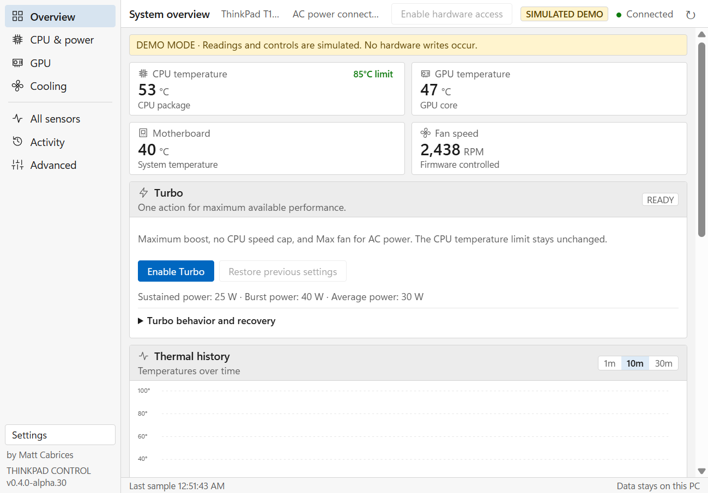
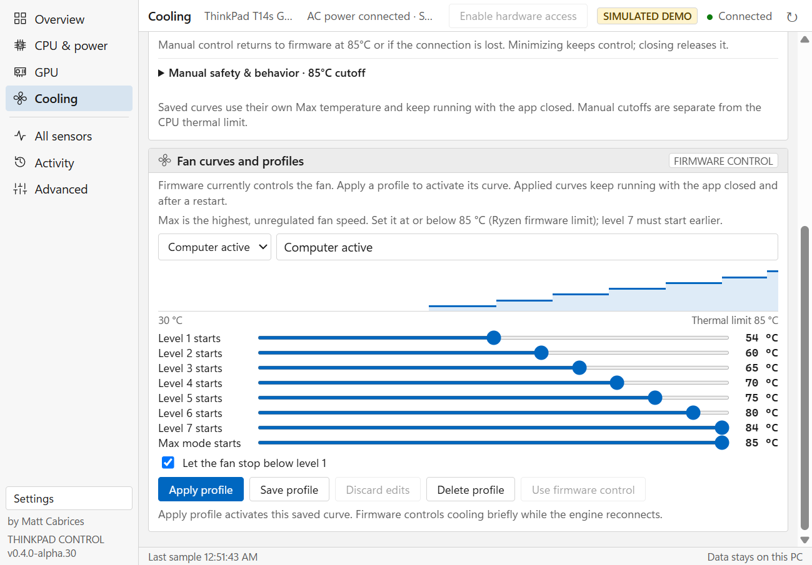

# ThinkPad Control

A Windows desktop app for ThinkPad owners who want to see what their hardware is doing and control cooling and CPU performance from one place.

Monitor temperatures, per-core clocks, power and fan RPM. Set a fan level or save a temperature curve. Manage processor boost and speed limits separately for AC and battery. On supported Ryzen systems, adjust the power limits exposed by the firmware.

Created by **Matt Cabrices**. Original code is [MIT licensed](LICENSE).

**Current status: 0.4.0-alpha.34, an unsigned development preview.** It is not yet a production release or a promise of universal ThinkPad support. Hardware observations exist for the T14s Gen 2 AMD and T14 Gen 3 AMD; the complete recovery/device matrix and installed Turbo validation remain open. See [compatibility](docs/COMPATIBILITY.md) and [release checks](docs/RELEASE.md).

**Latest installed Turbo check:** alpha.34 activated on the T14s Gen 2 with
40 W burst / 30 W average limit read-back, Maximum boost and Max fan. Restore
required one retry; all original settings were independently verified afterward.
These are accepted limits, not proof of sustained power delivery. See the
[current results and evidence](docs/RELEASE-VALIDATION.md).

Alpha.34 addresses a reproduced stale-telemetry failure during Turbo activation.
Fresh worker readings now reach the UI while activation runs; connection expiry
and thermal protection remain enforced. The alpha.34 upgrade and settings
preservation passed. A follow-up restoration-order fix is in source and still
needs a new installed-build check; it is not in the existing alpha.34 installer.

## What you can do

| Area | Controls and readings |
| --- | --- |
| Monitor | CPU/GPU temperatures, load, clocks and power where exposed; per-core clock details, sensor Min/Max and local history |
| Cooling | Measured fan RPM, firmware automatic mode, manual levels and Max cooling, plus saved temperature curves with a Max threshold |
| CPU & power | Separate AC/battery processor boost, Maximum boost and CPU speed limits; read-back and recovery for policy changes |
| Ryzen tuning | Firmware power and temperature limits on exact reviewed CPU/table mappings; unsupported or ignored fields stay read-only |
| Intel | Available telemetry and Windows CPU policies, including supported hybrid processor classes; reviewed PL1/PL2 readings are read-only |
| Turbo (experimental) | Coordinate Max fan, Maximum boost, no speed cap and supported Ryzen wattage ceilings, with captured settings and explicit Restore |

The GPU page shows the sensors and controls the driver exposes. Independent integrated Radeon/Intel GPU boost is unavailable; legacy NVIDIA auto-boost is driver gated. A named motherboard sensor is not guaranteed. Missing readings stay unavailable, and a zero tachometer reading does not prove the fan has stopped.



*Simulated demo data, not a benchmark or proof of hardware compatibility. The normal application runs in its own desktop window.*



*The saved curve editor includes a Max cooling threshold. This is a simulated preview; applying a curve is an explicit action.*

## How performance controls work together

**Processor boost permits higher clocks. CPU speed limit caps what Windows requests.** Turning boost off prevents boosting even if you raise the Ryzen wattage limits. Choosing No limit removes the speed cap; it does not turn boost on. Maximum boost enables boost and asks Windows to favor performance, while retaining the chosen speed cap.

Ryzen power limits set available power headroom, not a guaranteed power draw. Firmware, workload, cooling and other limits still determine actual clocks and sustained wattage. A setting is writable only when the adapter supports it and the requested value can be verified. Restore baseline uses the value observed when hardware access connected, not a hardcoded factory wattage.

[Turbo](docs/TURBO.md) combines the existing controls and saves their previous values before changing them. It does not raise temperature limits or promise continuous boost. **Closing the window returns manual cooling to firmware, but Turbo power settings remain until Restore previous settings is used.** Interrupted sessions retain a recovery action; startup never enables Turbo automatically.

## Getting started

The source is available here. A validated public binary release is still pending; build outputs described below are development candidates.

For an installer build, run `ThinkPad-Control-Setup-0.4.0-alpha.34-x64.exe`. Setup installs under Program Files, adds shortcuts and an uninstaller, and requests administrator approval to install hardware support. Node and .NET runtimes are included. WebView2 Runtime is required; setup links to Microsoft's download if missing. Initial driver/runtime acquisition needs internet access; normal operation needs no account, browser tab or terminal.

The package includes a source-built **TPFanCtrl2 2.5.1**, our documented fan-selector patch, its signed EC module, credits and matching sources. Setup configures the engine and hardware worker automatically. If PawnIO is absent, its official installer is downloaded and its pinned hash and signature checked. An existing external TPFanControl service is reported as a conflict and left untouched.

Hardware access connects automatically through an on-demand task registered during setup for its recorded Windows account. Another account or a missing task may require hardware-access approval again. The interface normally runs without elevation. Unsigned components may be blocked by Windows application control; do not disable security features to run this preview. Trusted signing remains a planned release milestone.

Start by checking **Overview**, then **Cooling** and **CPU & power**. Review [the desktop guide](docs/DESKTOP.md) for setup, control lifetime and recovery. A portable build must stay in its complete extracted folder and does not install privileged support from a user-writable directory.

- **Minimize:** hides to the tray and keeps manual fan control while telemetry and the lease remain valid.
- **Close window:** releases manual fan control to firmware. A saved service curve continues.
- **Exit:** stops the app and its owned background processes. Windows CPU policies and firmware power-limit requests are not a reset-on-exit feature.
- **Uninstall:** removes the owned task/service and app files; user data and the shared PawnIO driver remain.

Upgrades preserve validated fan curves and adjustments with backups and rollback. See [upgrade behavior](docs/UPGRADES.md).

## Try the interface without hardware access

With Node 24 installed, run either command from the source directory:

```powershell
npm run demo
npm run demo -- --demo-intel
```

Open `http://127.0.0.1:47831`. These clearly labelled simulations do not write hardware settings. No npm dependency installation is needed. The packaged desktop also supports `--demo` and `--demo-intel`.

## Build and test

Use Windows x64, Node **24.19.0**, .NET SDK **8.0.427**, PowerShell 7, Microsoft C++ v143 and Windows SDK **10.0.26100**. Installer builds also need Inno Setup **6.7.3** under `.tools/inno`; review its licensing for your build use.

```powershell
./scripts/fetch-dependencies.ps1
./scripts/fetch-build-notices.ps1
pwsh -File ./scripts/build-fan-engine.ps1
./scripts/build-native.ps1
./scripts/build-desktop.ps1  # -SkipInstaller for a portable-only build
npm run check
npm test
./scripts/verify-release.ps1
./scripts/package-source.ps1
./scripts/verify-archives.ps1
```

Windows CI builds unsigned candidates and runs isolated tests. It does not publish releases or change physical hardware. Dependency assets and matching upstream sources are pinned by SHA256. Source packaging excludes local tools, telemetry, build outputs and private keys. Bit-for-bit reproducible builds are not yet established.

Archive verification compares the finished portable/source ZIPs with the staged payload and current public source list. It rejects missing, changed, duplicate, unsafe and unexpected entries without extracting them. This checks build integrity; publisher trust and hardware validation are separate requirements.

## Architecture and documentation

| Directory | Purpose |
| --- | --- |
| `desktop/` | WinForms/WebView2 window, tray and hardware worker connection |
| `public/` | Desktop interface and renderer integration |
| `src/` | Loopback API, provider orchestration, SQLite history/audit and Turbo recovery |
| `native/` | Privileged sensor/policy worker, private IPC and fan watchdog |
| `native-tests/`, `tests/` | Isolated native, API, UI, recovery and packaging checks |
| `installer/`, `scripts/` | Setup, dependency verification and release tooling |
| `third-party/` | Dependency locks, licenses and attribution |
| `docs/` | Architecture, usage, hardware limits and release evidence |

[Architecture and database schema](docs/ARCHITECTURE.md) · [CPU clocks](docs/CPU-CLOCKS.md) · [Fan curves](docs/FAN-CURVES.md) · [Ryzen support](docs/RYZEN-COMPATIBILITY.md) · [Intel support](docs/INTEL-SUPPORT.md) · [Signing](docs/SIGNING.md) · [Contributing](CONTRIBUTING.md) · [Security](SECURITY.md)

## Credits

Thanks to **troubadix**, original TPFanControl author, and **ThinkPad-Forum, byrnes, Shuzhengz, FanDjango and mews-se** for continuing that work; **namazso** for PawnIO and its EC module; and the **LibreHardwareMonitor contributors** for sensor access.

Bundled projects retain their own licenses. Packages include upstream notices and matching TPFanCtrl2/PawnIO.Modules source archives. See [full attribution](third-party/README.md), [third-party notices](THIRD-PARTY-NOTICES.md) and [dependency review](docs/DEPENDENCY-REVIEW.md). ThinkPad Control is not affiliated with Lenovo, AMD, NVIDIA or these upstream projects.
